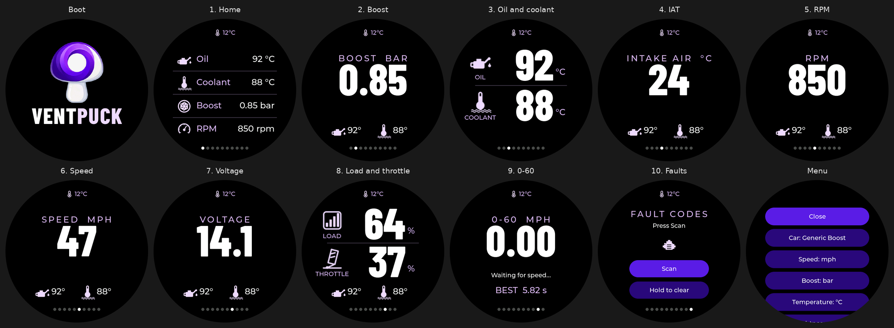
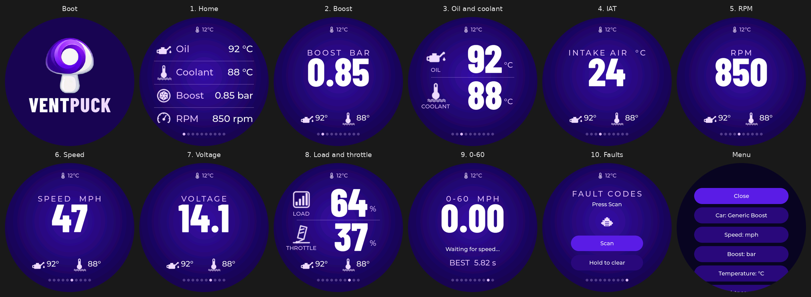

<p align="center">
  
</p>

<p align="center">
<a href="https://github.com/ProfessorShroom/VentPuck/releases"></a>
<a href="https://github.com/ProfessorShroom/VentPuck/actions/workflows/build.yml"></a>


<a href="https://github.com/ProfessorShroom/VentPuck/blob/main/LICENSE.md"></a>

## VentPuck

**_Copyright © Charlie Howard 2026 All rights reserved_**

A small round touch-screen gauge for your car's air vent. It reads live data from the OBD2 port over Bluetooth LE and shows it on a 1.75 inch AMOLED round display, running on an ESP32-S3.

Built for my Renault Megane 3 RS, with a generic OBD2 mode for other cars. Support for more cars can be added as people test it.

### Currently being tested on

- **Renault Megane 3 RS**
- **BMW E8x**


Releases and betas are on the [Releases](https://github.com/ProfessorShroom/VentPuck/releases) page.

### Features

- Swipe left and right between screens. The screen you were on last is remembered, so it boot back up into that screen.
- **Home** screen with four readings you choose, by default oil, coolant, boost and RPM.
- Single reading screens for boost, RPM, speed, battery voltage and intake air temperature, each with oil and coolant temperature always shown at the bottom.
- An **oil and coolant** screen that shows both temperatures large, and a **load and throttle** screen that shows engine load and throttle position together. Most cars report throttle position as 15% or so with your foot off, so VentPuck learns the closed position and shows that as 0%.
- **0-60 mph** timer (or 0-100 km/h if you use km/h). It arms itself when you scroll to it and reads speed at the full rate. Tap to reset, and your best time is saved.
- Outside air temperature at the top of every screen, which turns ice blue with a snowflake at 3°C or below. If the car doesn't report it, the battery voltage is shown instead on most screens. Both can be turned off with **Top reading** in the menu.
- **Shut down** in the menu turns VentPuck off. Tap the screen or cycle the power to start it again.
- **Fault codes** screen. Scan only runs when you press the button, and clearing codes is a tap and hold with a progress bar. It refuses to clear while the car is moving.
- Press and hold on any screen for the settings menu: car, speed, boost and temperature units, brightness, flip screen, top reading, start screen, home screen readings, boot animation, boot sound, dark mode, theme, update channel, shut down and version.
- Dark mode with a pure black background, which suits the AMOLED.
- Colour mode if you prefer which by default uses my classic blue to purple gradient. You can configure any colours you want in the .ini file.
- A choice of theme for the text, icons and buttons in either mode: purple, blue, cyan, green, yellow, orange, red, pink, white, BMW or BMW Modern. In colour mode it changes the background gradient too, and the purple theme uses your own gradient colours from the .ini file. BMW makes all the text the orange of a classic BMW instrument cluster, and BMW Modern makes the labels orange and the readings white.
- Boot animation with your own logo. Put a `logo.png` on the SD card to replace the default. This must be no larger than 1024x1024 and 1MB in size. I would suggest around 700x700 maximum for speed.
- OTA updates over Wi-Fi from GitHub, with a Release or Beta channel.

### Example screens

The boot screen, then in swipe order: Home, Boost, Oil and coolant, Intake air, RPM, Speed, Voltage, Load and throttle, 0-60 and Fault codes, then the settings menu.

Dark mode, the default:

<p align="center">
  
</p>

Colour mode:

<p align="center">
  
</p>

### Supported cars

| Setting | Car | What you get |
| --- | --- | --- |
| Megane 3 RS | Renault Megane 3 RS (X95) | Standard OBD2 readings plus oil temperature, boost, battery voltage and barometric pressure from the engine ECU. |
| Megane 4 RS | Renault Megane 4 RS (XFB) | Same requests as the Megane 3 RS: oil temperature, boost, battery voltage and barometric pressure from the engine ECU. Untested so far. |
| Clio 4 RS | Renault Clio 4 RS (X98) | Same requests as the Megane 3 RS: oil temperature, boost, battery voltage and barometric pressure from the engine ECU. Untested so far. |
| BMW E8x | BMW 1 Series E8x (E81 / E82 / E87 / E88) | Standard OBD2 readings plus an experimental oil temperature request to the engine computer, still being tested. No boost screen. |
| BMW E8x 135i/1M | BMW 135i and 1M (E82 / E88) | Same as BMW E8x, with the boost screen. |
| Generic Boost | Any turbo or supercharged car with OBD2 | Standard OBD2 readings only, so some screens such as oil temperature may show nothing. |
| Generic NA | Any naturally aspirated cars with OBD2 | Same as Generic Boost, without the boost screen. |

Changing the car restarts the gauge.

### Hardware

- **Display / controller** - a Waveshare ESP32-S3-Touch-AMOLED-1.75, which is an ESP32-S3 with a 1.75 inch AMOLED 466x466 round capacitive touch display.
- **OBD2 adapter** - any Bluetooth OBD2 adapter that supports **BLE** ELM327-style adapter. The ESP32-S3 doesn't support Bluetooth Classic, so Classic-only adapters won't work. I used the OBDLink CX as it supports a sleep function to reduce power drain when the car is parked for longer than a few days, but the cheaper ones will work fine.
- **Power** - 12 V to 5 V buck converter on a fuse piggyback, so the gauge turns on and off with the ignition. You could also use a USB C cable plugged in to the 12v socket like a phone charger, but this is a lot less neat.
- **SD card (optional)** - for `settings.ini` and a custom `logo.png`. VentPuck works fine without one, and the on-screen menu saves your settings to the gauge itself.

### Settings

Everything is optional. If there's an SD card, VentPuck creates a `settings.ini` on the first run, and the on-screen menu keeps it up to date.

```ini
vehicle=meganers3
adapter_name=OBDLink
update=true
update_channel=release
ssid=YourWifi
password=YourPassword
ssid2=YourWifi2
password2=YourPassword2
ssid3=YourWifi3
password3=YourPassword3
ssid4=YourWifi4
password4=YourPassword4
ssid5=YourWifi5
password5=YourPassword5
colour1=#1A0650
colour2=#3A12A8
speed_unit=mph
boost_unit=bar
temp_unit=C
start_screen=last
home_items=oil,coolant,boost,rpm
brightness=80
flip_screen=false
top_reading=true
boot_animation=true
boot_sound=true
dark_mode=true
theme=purple
sd_log=false
```

| Key | Values |
| --- | --- |
| `vehicle` | `generic` (Generic Boost), `genericna` (Generic NA), `meganers3`, `clio4rs`, `megane4rs`, `bmwe8x`, `bmwe8xturbo` (135i / 1M) |
| `adapter_name` | Part of the adapter's Bluetooth name, not case sensitive (default `OBDLink`). Leave it empty to use the first BLE OBD adapter it finds |
| `update` | `true` or `false`, whether to check for updates in the background after it starts |
| `update_channel` | `release` or `beta` |
| `ssid`, `password` | Your Wi-Fi, only used to check for updates, you can provide up to 5 different networks |
| `colour1`, `colour2` | Dial gradient as hex `#RRGGBB`, outer edge and middle, used with the `purple` theme |
| `speed_unit` | `mph` or `kph` |
| `boost_unit` | `bar`, `psi` or `kpa` |
| `temp_unit` | `C` or `F` |
| `start_screen` | `last`, `home`, `boost`, `temps`, `rpm`, `speed`, `voltage`, `iat`, `load`, `zerosixty` or `faults` |
| `home_items` | Four of `boost`, `oil`, `coolant`, `rpm`, `speed`, `voltage`, `iat`, `load`, `throttle` |
| `brightness` | 5 to 100 |
| `flip_screen` | `true` or `false`, turns the display and touch upside down for a gauge that is mounted upside down (also in the menu as **Flip screen**) |
| `top_reading` | `true` or `false`, shows the outside temperature at the top of the screen, or the battery voltage if the car doesn't report it (also in the menu as **Top reading**) |
| `boot_animation` | `true` or `false` |
| `boot_sound` | `true` or `false`, a short chime through the speaker at start up |
| `dark_mode` | `true` or `false` (default `true`) |
| `theme` | Theme, in both dark and colour mode: `purple`, `blue`, `cyan`, `green`, `yellow`, `orange`, `red`, `pink`, `white`, `bmw` (all text BMW cluster orange) or `bmwmodern` (orange labels, white readings). The old `accent` key still works |
| `sd_log` | `true` or `false`, writes the serial output to `ventpuck.log` on the card (also in the menu as **SD logging**) |

The Wi-Fi password is stored as plain text, and Wi-Fi is only ever used to check for updates.

### Updates

Flash VentPuck over USB once, then it can update itself over Wi-Fi from the releases on this page. Set `update=true` and your Wi-Fi details in `settings.ini`. The check runs quietly in the background once VentPuck has connected to the car. Bluetooth and Wi-Fi share the same radio, so the readings pause while it checks and show `--` until it's done, then carry on as normal. If it finds a newer version, it downloads and installs it in the background, and the new version runs the next time VentPuck starts. You can also run a check from the menu with **Check for updates now**, which shows progress on screen and restarts straight into the new version.

Release versions look like `1.0.0.0` and betas look like `1.0.0.0b1`. On the Release channel only releases are used. On the Beta channel a beta is only used if it's newer than the latest release, so if the release and beta are the same version, or the release is newer, you get the release. Betas are test builds that may be unstable, so choosing Beta in the menu shows a warning first.

### Building

VentPuck is written in C++ with PlatformIO, LVGL and NimBLE-Arduino.

```bash
pio run -e ventpuck -t upload
```

### Changelog

#### Latest Update

**Version 1.1.4.0**

- **_1.1.4.0_** **Brightness** in the menu now steps every 10%, from 10% to 100%, instead of every 20%.
- **_1.1.4.0_** The home screen readings, labels and icons are bigger and easier to read at a glance.


#### Older Updates

<details markdown="1">
<summary><strong>Version 1.x</strong></summary>

**Version 1.1.3.0**

- **_1.1.3.0_** Two new themes, **BMW** and **BMW Modern**. BMW makes all the text and icons the orange of a classic BMW instrument cluster. BMW Modern makes the labels, units and icons orange and the readings white.
- **_1.1.3.0_** **Accent** is now called **Theme**, in the menu and in `settings.ini` (`theme`). The colours work as before under the same names, and an existing `accent` setting is still read.
- **_1.1.3.0_** The VENT PUCK wordmark in the boot animation now follows the theme.
- **_1.1.3.0_** Dark mode is now on by default. If you've already set `dark_mode`, your setting is kept.
- **_1.1.3.0_** The automatic update check now pauses the car readings while it runs, and tries Wi-Fi up to three times. Bluetooth and Wi-Fi share the same radio, and with the readings running the check often couldn't connect or download, so updates only worked from **Check for updates now**. The readings show `--` during the check, then carry on as normal.

**Version 1.1.2.0**

- **_1.1.2.0_** The outside temperature turns ice blue with a snowflake at 3°C (37°F) or below, as a frost warning.
- **_1.1.2.0_** If the car doesn't report an outside temperature, the battery voltage is shown at the top instead. It's left out on the Voltage screen, on the home screen if Voltage is one of its readings, and on the 0-60 screen so the timer keeps its full speed.
- **_1.1.2.0_** **Top reading** in the menu (`top_reading` in `settings.ini`), which turns off the outside temperature and voltage at the top of the screen. It's on by default, and when it's off they aren't requested from the car for the top of the screen either.
- **_1.1.2.0_** **Shut down** in the menu, which disconnects from the adapter, turns the screen off and puts VentPuck to sleep. Tap the screen or cycle the power to start it again.
- **_1.1.2.0_** The outside temperature has moved from the top right to the top middle of every screen, with a thermometer icon, so it no longer crowds the large readings.
- **_1.1.2.0_** The β badge on beta builds has moved to the top middle too, next to the outside temperature.

**Version 1.1.1.0**

- **_1.1.1.0_** **Flip screen** in the menu (`flip_screen` in `settings.ini`), which turns the display and touch by 180 degrees for a gauge that is mounted upside down. It changes straight away, and the boot and update screens are flipped too.

**Version 1.1.0.0**

- **_1.1.0.0_** New `adapter_name` setting, so adapters other than the OBDLink can be used. It matches part of the adapter's Bluetooth name (default `OBDLink`). Leave it empty to use the first BLE OBD adapter it finds.
- **_1.1.0.0_** Support for adapters that use the FFE0/FFE1 Bluetooth serial service, which many ELM327 clones use, as well as the FFF0 one.
- **_1.1.0.0_** The accent colour now works in colour mode too, not just dark mode. It changes the background gradient, text, icons, buttons, menu, boot animation and update screen. The purple accent keeps the classic look and still uses `colour1` and `colour2` from `settings.ini`. The **Accent** setting is now in the menu in both modes.
- **_1.1.0.0_** IAT is now labelled "Intake Air" on the home screen, its own screen and the start screen setting, to match Oil and Coolant.
- **_1.1.0.0_** Oil, coolant, Intake Air and ambient temperatures are now read every 2 seconds and voltage every second, instead of on every cycle. That leaves more of the Bluetooth link for RPM, boost and speed, so they update faster, which also helps the 0-60 timer. A reading that's missing is retried sooner, so a new screen fills straight away.
- **_1.1.0.0_** The automatic update check no longer holds up start up. It used to take up to about 35 seconds before the car connection started. Now it runs in the background once the adapter is connected (or after 30 seconds without a car). It installs any update it finds, and the new version runs the next time VentPuck starts. **Check for updates now** in the menu still works as before, with progress on screen.
- **_1.1.0.0_** On the BMW, oil temperature (which takes about 10 adapter commands per read) no longer slows down every other reading.
- **_1.1.0.0_** If the adapter disconnects, for example on a stall-start or a flaky adapter, VentPuck now reconnects in place instead of restarting. You no longer get the boot animation, sound and update check again.
- **_1.1.0.0_** A reading that stops updating now shows `--` after 10 seconds, instead of freezing on the last value as if it were live. All readings clear when the adapter disconnects.
- **_1.1.0.0_** One glitchy low throttle reading can no longer be saved as the closed-throttle position. The zero point now only moves after 5 low readings in a row.
- **_1.1.0.0_** The serial console no longer calls itself "VentPuck OBDLink CX test".
- **_1.1.0.0_** Fixed a possible random restart when a reply from the adapter arrived late. The reply buffer was shared between two tasks without a lock.
- **_1.1.0.0_** A late reply to one command can no longer be read as the answer to the next one.

**Version 1.0.1.0**

- **_1.0.1.0_** Throttle position now learns your car's closed position and shows it as 0%, instead of around 15% with your foot off.
- **_1.0.1.0_** Load and throttle readings are now included in the serial and SD card log, along with the raw throttle value.

**Version 1.0.0.0 - Initial Release**

- **_1.0.0.0_** Inital Release of VentPuck

</details>
